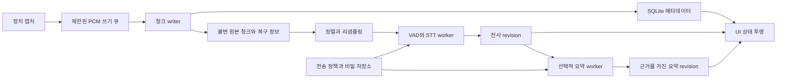

# Recoryn Architecture & Expert Review v1.0

설계 작성일: 2026-11-14. 상태: 구현을 위한 제안 명세. 애플리케이션 구현과 Windows 하드웨어 검증은 별도 게이트다. VoiceLocal v0.1.0은 사용자 제시 기준이며 원본 소스 이관 및 비교는 소스 확보 후 수행한다.

Recoryn은 녹음을 AI 처리와 독립적으로 보존하고, 사용자가 전송 대상을 선택하며, 전사·요약의 근거에서 원본 음성까지 찾아갈 수 있는 Windows 앱을 목표로 한다. 이 명세는 [설계 입력](design-input-v1.md)의 반복 본문을 정리하고 녹음과 작업 상태, 저장 및 복구, 개인정보 계약을 구현 가능한 경계로 구체화한다.

## 제품 범위와 원칙

첫 구현은 로컬 저장을 갖춘 마이크·시스템 분리 녹음과 장애 복구다. AI 설치 여부와 모델 오류는 녹음 시작 조건이 아니다. STT와 요약은 독립 선택이며 클라우드 자동 전환은 기본 차단한다. 로컬 Faster-Whisper와 선택적 로컬 Ollama가 초기 AI 경로다. 모델 설치도 사용자 동작과 라이선스 확인이 필요하다.

원본 청크는 확정 후 덮어쓰지 않는다. 리샘플링, 정렬, 믹스, 잡음 처리, 전사 정정과 사용자 편집은 새 버전의 파생 산출물이다. 원본 불변은 영구 보존을 뜻하지 않으며 명시적 삭제·보존 정책이 우선한다. 사고로 유실된 구간을 무음으로 메워 정상 녹음처럼 표시하지 않는다.

## 전문가 검토와 의사결정

| 관점 | 책임 | 검토 산출물 |
| --- | --- | --- |
| 수석 아키텍트 | 경계, 상태, 계약, 마이그레이션, 성능 예산 | [아키텍처 검토](reviews/architecture.md) |
| Windows 오디오 | WASAPI, 시계, 드리프트, 장치·절전·저장 장애 | [오디오와 복구](reviews/audio-recovery.md) |
| ML 시스템 | VAD, 전사 버전, 요약 근거, GPU, 평가 | [AI와 UX](reviews/ai-ux.md) |
| 보안 및 라이선스 | 전송, 비밀, 삭제, 다운로드, 배포 조건 | [보안과 QA](reviews/security-qa.md) |
| 데스크톱 UX | 녹음 상태, 접근성, 복구, 시간 탐색, 편집 | [AI와 UX](reviews/ai-ux.md) |
| QA 및 릴리스 | 장애 주입, 하드웨어, 성능, 설치와 배포 증거 | [보안과 QA](reviews/security-qa.md), [검증 계획](validation-plan.md) |

전문가 역할은 설계 검토 기준이다. 오케스트레이터는 충돌하는 제안을 통합 명세로 정리하며, 채택과 보류 이유를 결정 기록에 남긴다. 세션 운영과 신규 참가 절차는 [협업 규칙](collaboration/workflow.md)을 따른다.

공용 계약의 정본은 이 문서이며 시험 ID와 수락 조건의 정본은 [검증 계획](validation-plan.md)이다. `docs/reviews/`의 1차 검토는 근거와 대안이며 정본과 다른 상태명·수치·저장 순서를 그대로 구현하지 않는다. 검토 ID는 문서별 namespace를 사용한다(D01/A01과 D02/A01은 다른 항목). 교차 검토 발견 사항은 [종결 기록](reviews/design-signoff.md)에서 추적한다.

## 모듈 경계

```text
src/recoryn/
  domain/          세션, 트랙, 청크, 세그먼트, 작업과 제공업체 계약
  app/             조립, 서비스, UI용 상태 투영과 명령 처리
  ui/              PySide6 위젯, 접근성, Qt signal 연결
  capture/         입력 어댑터, 캡처 제어, PCM 블록 생산
  audio/           시계 매핑, 리샘플링, VAD, 레벨, 파생 믹스
  storage/         청크 writer, manifest, SQLite, 복구와 내보내기
  jobs/            제한 큐, 취소, 재시도, 작업 lease와 자원 배정
  transcription/   로컬 및 선택적 클라우드 STT 어댑터
  summarization/   Ollama 및 선택적 클라우드 요약 어댑터
  security/        비밀 저장소, 전송 정책, 경로 검증과 가림
  diagnostics/     구조화한 로그, 상태 측정, 지원 번들
```

`domain`은 Qt, 장치 SDK, 네트워크 클라이언트와 모델 런타임을 import하지 않는다. `app`은 domain 계약으로 서비스를 조합하고 UI는 앱 명령과 읽기 모델만 사용한다. 각 어댑터는 내부 모델 타입을 domain DTO로 변환한다. 제공업체별 SDK는 선택 의존성으로 로드하며 미설치 상태는 기능 없음으로 표시한다. UI 스레드가 모델 로딩, 전사, 파일 변환을 기다리지 않는다.

캡처 실행 단위, 저장 writer, AI worker를 분리한다. AI는 확정 청크 또는 파생 오디오 참조를 소비한다. 캡처와 저장 사이에는 제한된 큐를 두고, 실시간 AI와 UI 구독은 별도 큐로 분리한다. AI가 느리면 실시간 미리보기를 건너뛰고 확정 청크에서 나중에 처리한다. 저장 경로의 큐가 포화되면 데이터 유실을 계수하고 녹음 건강 상태를 즉시 올린다.



## 상태와 실행 계약

녹음 수명과 처리 진행률을 하나의 상태 값에 넣지 않는다. `READY`, `TRANSCRIBING`, `SUMMARIZING`, `COMPLETE`는 작업과 산출물로 계산한 UI 표시다. 요약을 선택하지 않아도 녹음이나 전사 완료를 막지 않는다.

| 모델 | 상태와 전이 | 장애 및 재개 |
| --- | --- | --- |
| Session | `CREATED → RECORDING ↔ PAUSED → FINALIZING → FINALIZED`; CREATED/RECORDING에서도 FINALIZING 가능 | 프로세스 종료·저장 중단은 `INTERRUPTED`, 복구 후 PAUSED 또는 FINALIZING. 재녹음은 명시적 사용자 동작과 새 epoch로만 시작 |
| Track health | `OK`, `DEGRADED`, `UNAVAILABLE`, `STOPPED` | 한 트랙 장애는 나머지 녹음을 유지하고 시간 gap을 기록. 전체 저장 불가면 세션을 INTERRUPTED로 전환 |
| Job | `QUEUED → RUNNING → SUCCEEDED`; 실행 전 `BLOCKED(reason)` 가능, 재시도 가능한 오류는 BACKOFF → QUEUED | QUEUED/BLOCKED/BACKOFF에서 CANCELLED 가능. RUNNING → CANCEL_REQUESTED → CANCELLED. terminal은 SUCCEEDED/FAILED/CANCELLED이며 수동 재실행은 새 Job |
| Attempt | `RUNNING → SUCCEEDED/FAILED/CANCELLED/ABANDONED/UNKNOWN` | 자동 재시도는 같은 Job의 새 attempt. local worker 상실은 ABANDONED, 원격 결과 불명은 UNKNOWN. 이력 초기화 금지 |
| Artifact | `STAGING → VERIFIED → PUBLISHED` | 실패한 staging은 완료본으로 게시하지 않는다. 이전 PUBLISHED revision은 보존 |

PAUSED는 모든 필수 트랙의 입력 gate 중단 확인과 이전 epoch의 writer drain/seal이 끝난 상태다. 요청 중에는 capture state에 `pending_command=PAUSE`와 진행 상태를 함께 표시하며 PAUSED로 먼저 전환하지 않는다. pause cutoff는 트랙별 gate 종료의 확인 시각과 마지막 accepted sequence/fragment로 고정하며 클릭 시각과 구분한다. cutoff 전 수락한 큐는 저장하지만 이후 신규 입력과 AI tap 전달은 차단한다. late callback도 같은 gate를 검사한다. resume은 PAUSED 이후에만 허용하고 새 epoch로 시작한다.

stop도 같은 gate·cutoff·마지막 유실 누계와 writer ack를 별도 제어 경로로 전달한다. 포화된 PCM 큐의 stop marker 하나에 의존하지 않는다. 필수 트랙의 ack와 수락·유실 frame 회계를 모두 확인하기 전 정지·pause 성공을 표시하지 않는다. 시작 실패는 안전한 오류를 남기며, 현재 실행에서 오디오가 실제로 수락되고 모든 장치가 준비되기 전에는 REC로 표시하지 않는다. 구현은 RECORDING을 먼저 영속한 뒤 장치를 열므로, 일부 트랙이 이미 수락됐을 수 있는 시작 실패는 모든 장치 해제 ACK와 writer drain/seal이 끝난 뒤 원본 보존을 위해 PAUSED로 둔다. ACK가 끝나지 않으면 종료 확인 대기(`CAPTURE_START_FAILED_ACK_PENDING`, RECORDING 유지)로 남기며 PAUSED나 정지 성공으로 표시하지 않는다(ADR11). 모델 종료를 기다리느라 정지를 미루지 않는다.

정지 순서는 신규 입력 차단 → writer drain과 청크 검증 → AudioRevision/FINALIZED DB commit → manifest projection이다. 원본과 DB 확정 실패·중단은 INTERRUPTED로 처리한다. DB 확정 후 manifest만 실패하면 FINALIZED를 유지하고 `manifest_sync_pending`과 재시도를 표시한다. stop 응답은 원본 확정 완료와 manifest pending을 구분하고 원본 성공을 rollback하지 않는다. 해당 manifest가 필요한 프로젝트 export는 projection 완료 전 성공 처리하지 않는다. FINALIZED 자체는 유실 없음이나 AI 완료를 의미하지 않는다.

각 영속 전이는 기대 상태와 `state_version`을 비교하고 전이 이벤트와 함께 SQLite transaction에 기록한다. 장치에서 발생한 관측 사실은 먼저 메모리에 계수할 수 있지만, DB 실패 시 영속화됐다고 표시하지 않는다. 제어 상태 저장 불가 시 추가 작업을 차단하고 세션을 안전하게 종료·복구 대상으로 남긴다.

작업은 `job_id`, `attempt_id`, 입력 artifact/revision, 정책·모델·설정 digest, idempotency key, 취소 token, owner, 증가하는 fence token을 갖는다. v1.0은 lease 만료 시각을 두지 않고, 재시작 시 단일 coordinator가 이전 작업·reader 프로세스의 종료를 명시적으로 확인한 뒤에만 회수한다(ADR12). 이 확인은 호출자의 진술이며 OS 생존 검사로 자동 증명하는 것이 아니다. 만료 기반 lease는 다중 프로세스 worker를 도입할 때 다시 본다. 워커 종료 후 attempt를 ABANDONED 또는 UNKNOWN으로 닫고 Job을 BLOCKED로 옮겨 재실행 조건을 재검사한다. 이전 fence의 늦은 결과는 게시하지 않는다. 취소는 완료되지 않은 작업을 중단하며 이미 외부로 보낸 데이터나 이미 게시한 산출물을 되돌리지 않는다. 외부 중단이 불명확하면 BLOCKED(CANCEL_UNCONFIRMED)로 두고 자동 재전송하지 않는다. 구현은 같은 의미를 BLOCKED(REMOTE_UNKNOWN)와 `cancel_requested=1`로 표현하고 재개를 거부한다(ADR14).

결과 게시 transaction은 현재 Job의 실행·취소 의도, attempt/fence, 삭제 세대와 입력 버전을 검사한 뒤 artifact/revision 행, 선택 포인터 변경, Job/Attempt 완료와 outbox를 함께 commit한다. 취소 transaction도 같은 직렬화 경계에서 fence를 회수한다. 성공 게시가 먼저 commit되면 취소는 ALREADY_SUCCEEDED로 응답하고, 취소가 먼저면 새 게시·하위 dispatch를 차단한다. 재시작 복구는 취소 의도를 보존한다. 실제 파일의 최종 경로 게시는 이 transaction보다 앞서며 DB 게시 실패 파일은 비활성 후보로 남는다.

논리 Job의 동일성 키는 입력 revision/hash, timeline, 모델·의미 설정·템플릿과 출력 계약 version이다. 장치·batch·worker처럼 검증된 동일 의미 실행 조정은 versioned Attempt ExecutionPlan을 새로 만들 수 있다. 모델·입력·출력 의미나 context 분할 의미가 달라지면 새 Job을 생성한다. 체크포인트는 별도 호환 키를 검사해 불일치 시 재사용하지 않는다. CPU 허용만 달라진 새 attempt도 외부 전송이나 모델 변경 권한을 상속하지 않는다.

| provider 오류와 우선순위 | 영속 상태와 실행 정책 | UI 표시 |
| --- | --- | --- |
| 취소·삭제 | 게시 fence 회수, 새 dispatch 금지, 취소 절차 유지 | 취소/삭제 중과 부분 보존 범위 |
| REMOTE_OUTCOME_UNKNOWN 또는 outcome_known=false | Attempt UNKNOWN, Job BLOCKED(REMOTE_UNKNOWN), 비용 노출 유지. retryable=true보다 우선 | 원격 결과·비용 미확인, 자동 재전송 없음 |
| 동의·인증·capability | BLOCKED(CONSENT/AUTH/CAPABILITY), 전송 금지 | 설정·권한 필요 |
| 자원·예산 | BLOCKED(RESOURCE/BUDGET), 허용 정책 재검사 | WAITING_USER는 이 상태의 UI 투영이며 별도 Job enum 아님 |
| 알려진 일시 오류 | 유한 backoff 후 새 attempt, 동의·예산 재검사 | 재시도 대기와 남은 시도 |
| 입력·무결성 오류 | FAILED와 안전한 복구 행동, 기존 게시본 유지 | 오류와 보존된 결과 |

provider DTO는 이 절과 AI 계약의 Request/ExecutionPlan/Event/Error 의미를 정본으로 하며 오류에는 code, stage, retryable, outcome_known, safe_message와 preserved_artifacts를 포함한다. SDK 자체 retry는 위 정책을 우회하지 않도록 비활성화하거나 검증된 통제 하에 둔다.

## 시간과 오디오 계약

`PCMBlock`은 `session_id`, `track_id`, `epoch_id`, `block_seq`, `format_id`, `frame_count`, `device_frame_position`, `capture_mono_ns`, `clock_quality`, 상태 flags와 PCM payload를 가진다. 포맷은 sample rate, channel count 및 layout, sample type, byte order와 frame 크기를 포함한다. 장치 어댑터는 기본 포맷을 기록하고 STT용 변환은 별도 worker에서 수행한다.

여기서 native와 원본은 OS의 선택 endpoint에서 앱에 전달된 PCM을 뜻하며 물리 ADC의 원신호를 뜻하지 않는다. 공유 모드 mix format과 장치 하드웨어 포맷은 다를 수 있다. 시스템 트랙도 선택한 render endpoint의 loopback이며 모든 출력 장치와 보호 콘텐츠를 포함한다고 보장하지 않는다. 요청 포맷과 실제 포맷, sample container/valid bits, channel mask를 구분한다. [GetMixFormat](https://learn.microsoft.com/en-us/windows/win32/api/audioclient/nf-audioclient-iaudioclient-getmixformat), [WASAPI loopback](https://learn.microsoft.com/en-us/windows/win32/coreaudio/loopback-recording)

블록 유일 키는 `(track_id, epoch_id, block_seq, fragment_index)`다. 새 실행·재연결·재개는 새 epoch를 사용하므로 과거 번호와 충돌하지 않는다. queue에서 탈락한 패킷도 sequence를 소비하되 가변 길이 패킷의 sequence 차이로 유실 frame 수를 추정하지 않는다. 큰 패킷 분할은 fragment count와 frame offset을 기록한다. OS의 SILENT flag는 명시적 zero-fill과 flag로 보존하고 패킷 미도착·timestamp 오류와 구분한다.

capture critical path는 사전 할당 버퍼 복사와 제한된 enqueue, 장치 buffer 반환으로 제한한다. 포화 정책은 drop-newest이며 이미 수락한 순서를 유지한다. 큐는 slot과 byte 상한을 함께 가지며 pool을 무한 확장하지 않는다. 유실 누계와 건강 상태는 같은 포화 큐에만 의존하지 않는 별도 상태로 전달한다. 마지막 누계가 영속화되기 전 종료되면 미상 꼬리로 남긴다. AI tap 유실, 앱 queue drop과 backend discontinuity의 중복 증거는 같은 frame 범위에서 이중 합산하지 않는다. Python의 nonblocking queue API 호출만으로 GIL·lock을 포함한 실시간 특성이 보장됐다고 보지 않는다.

장치 시계, 세션 단조 시계와 UTC 표시 시각을 구분한다. raw QPC tick은 frequency로 변환하며 WASAPI의 QPC 위치와 같은 단위라고 가정하지 않는다. 각 run의 clock domain과 UTC anchor·불확실성을 저장하고 재부팅 전후 단조 시각을 직접 빼지 않는다. 장치 재연결, 포맷 변경, 절전 복귀 시 epoch를 새로 만들고 시계를 연속으로 추정하지 않는다. WASAPI `GetBuffer`는 장치 위치와 QPC 위치, 불연속·타임스탬프 오류 flags를 제공한다. QPC 위치는 해당 API에서 100ns 단위이므로 어댑터가 명시적으로 ns로 변환한다. 해당 정보가 없는 백엔드는 낮은 시간 품질로 보고한다. [Microsoft GetBuffer](https://learn.microsoft.com/en-us/windows/win32/api/audioclient/nf-audioclient-iaudiocaptureclient-getbuffer)

`capture_mono_ns`는 유효한 첫 sample 상관 시각만 담는 nullable 값이다. 패킷 도착 시각은 별도 `arrival_mono_ns`와 clock domain에 저장하며 해당 값을 capture 필드에 대입하지 않는다. TIMESTAMP_ERROR 또는 유효하지 않은 위치의 표본은 drift 적합에서 제외한다. arrival 기반 추정은 별도 mapping과 품질로 남기고, 같은 epoch에서 시각·위치가 역행하면 연속 mapping 구간을 분리하거나 unknown으로 처리한다. 참조 가능한 끝 시각이 없으면 정밀한 시간 범위를 만들어내지 않는다.

정렬은 epoch별 `session_time = a × device_frame_position + b` 매핑과 품질·오차 추정을 기록한다. 동일 샘플 인덱스를 서로 다른 장치에서 같은 시각으로 취급하지 않는다. 드리프트 보정은 파생 리샘플링에만 적용한다. 계수, 근거 시점, 소스 청크와 변환 버전을 저장해 원본 frame 범위로 역추적한다. 시계가 불확실하면 추정 정렬과 그 한계를 표시한다.

트랙별 gap은 원인, 시작·끝 또는 미상 범위, 알려진 유실 프레임과 정확도를 가진다. app queue 유실과 장치가 보고한 유실을 분리한다. 알 수 없는 유실량을 0으로 기록하지 않는다. 일시정지·절전·분리 구간은 타임라인에 남기고 녹음된 시간과 경과 시간을 따로 표시한다. 장치 자동 대체는 사용자 설정 없이 수행하지 않는다. 에코·중복 발화 완화는 원본에 적용하지 않고 선택적 파생 처리로 둔다.

## 저장과 복구 계약

데이터는 Git 저장소 밖의 사용자 전용 로컬 경로에 둔다. SQLite WAL을 사용하는 활성 저장소는 로컬 디스크로 제한한다. 네트워크·동기화 폴더는 지원 시험 전 활성 저장 위치로 허용하지 않는다. WAL은 같은 호스트의 공유 메모리와 locking 조건을 전제로 한다. [SQLite WAL](https://www.sqlite.org/wal.html)

SQLite는 세션 상태, 작업, 전사·요약 revision, 동의와 삭제 의도의 기준이다. 원본 파일과 그 불변 descriptor는 복구 가능한 미디어의 기준이다. `manifest.json`은 원본 목록과 타임라인을 담는 versioned snapshot이며, DB와 독립된 완전한 두 번째 업무 DB로 취급하지 않는다. 파일과 SQLite를 하나의 원자 transaction이라고 주장하지 않는다.

```text
data/
  library.sqlite
  sessions/<session_id>/
    manifest.json
    tracks/<track_id>/<epoch_id>/<chunk_seq>/
     audio.pcm
      blocks.jsonl
     descriptor.json
    staging/
    derived/<artifact_id>/
  deletion-journal/
```

전사·요약 revision은 세션 폴더의 JSON 파일이 아니라 `library.sqlite`의 content 테이블(`content_revisions` 등)에 둔다(ADR13). 내보내기는 이 revision에서 파일을 만든다.

청크 bundle의 descriptor에는 schema version, 식별자, 포맷, 첫·마지막 시간, frame 범위, block sequence 범위, flags/gap, byte count와 checksum을 둔다. 해시는 저장 중 손상을 탐지하기 위한 것이며 외부 공격에 대한 인증 서명을 대신하지 않는다. 청크 목표 길이와 큐 용량은 성능 시험으로 확정한다. 긴 세션도 하나의 무제한 WAV로 쓰지 않으며 WAV 구조는 정식 파서로 읽는다.

초기 저장 형식은 raw PCM과 복구 가능한 블록 journal의 bundle을 채택한다. `blocks.jsonl`의 각 완성 레코드는 schema, block sequence, epoch/format, PCM offset·length·frame 수, 시각과 flags/gap, payload checksum 및 레코드 checksum을 가진다. writer는 payload를 쓴 뒤 해당 레코드를 append한다. 부분 레코드나 PCM 범위를 벗어난 레코드에서 복구를 멈추고 이전의 검증된 prefix만 채택한다. journal에 없는 PCM 꼬리의 시각을 추측하지 않는다. 봉인 descriptor는 prefix의 합과 최종 hash를 검증한다. 실제 serializer·flush 순서는 golden fixture와 crash 시험 후 고정하며 `.rcpcm` 독자 컨테이너는 초기 필수 형식으로 채택하지 않는다.

유효 data 레코드는 `[0, verified_end)`의 PCM 범위를 겹침·누락 없이 연속 덮어야 한다. offset, length와 frame alignment가 일치하고 track/epoch/format과 sequence/fragment 키가 유일하며 순서가 유효해야 한다. 같은 레코드의 중복 append도 prefix 위반이다. payload가 없는 gap/event 레코드는 data와 다른 kind로 구분하고 offset 진행을 바꾸지 않는다. PCM과 journal의 torn write, 중복·역행·다른 epoch·부분 fragment를 독립 검증하며 봉인 시 양 파일과 descriptor를 함께 검사한다.

writer는 다음 순서를 지킨다.

1. 같은 볼륨의 고유 staging 디렉터리에 PCM과 descriptor를 작성한다. 메모리나 큐에만 있는 데이터는 저장됐다고 표시하지 않는다.
2. PCM을 닫고 byte/frame 정합성 및 checksum을 확인하며, 명시한 flush 정책에 따라 파일을 동기화한다.
3. 완성 bundle을 고유 최종 경로로 게시한다. 기존 청크는 덮어쓰지 않는다. 파일시스템의 게시·flush 순서와 전원 차단 보장은 하드웨어 시험 대상이다.
4. SQLite에 청크 인덱스와 상태를 transaction으로 반영한다. bundle이 있고 DB 반영이 없으면 복구 시 재등록한다.
5. 단일 manifest writer가 새 generation을 임시 파일에 쓰고 검증 후 교체한다. snapshot이 뒤처져도 descriptor를 재조회해 복구할 수 있다.

복구는 세션 lock을 얻고 삭제 의도를 먼저 확인한다. live writer가 있는 세션을 동시에 복구하지 않는다. descriptor와 파일을 검사해 게시된 고아 bundle을 재등록하고, 누락·손상 참조는 건강 상태에 표시한다. staging의 검증 가능한 frame은 새 복구 artifact로 보존하고 불명확한 데이터는 격리한다. DB가 손상되면 미디어 목록을 재구축할 수 있으나 동의·편집·작업 이력이 복원됐다고 간주하지 않는다. 동의는 없어진 것으로 처리한다.

FINALIZED 이후의 고아 bundle은 자동으로 봉인 AudioRevision에 추가하지 않는다. 기본 후보/격리로 두며 사용자가 채택하면 새 AudioRevision과 필요한 timeline revision을 생성한다. 기존 목록/hash와 전사·편집의 입력은 유지하고 최신 오디오 대비 readiness를 다시 계산한다. DB 손상이나 삭제 이력의 완전성을 확인할 수 없는 경우는 읽기 전용 inventory만 허용하고 자동 재등록·게시를 보류한다. 복구 사본을 여는 사용자 동작도 전송 동의를 복원하지 않는다.

프로세스 강제 종료 시 마지막 검증된 청크까지 복구하는 것이 P0 목표다. 아직 확정되지 않은 청크, OS cache, 저장장치 고장과 전원 장애의 복구 범위는 별도 측정한다. SQLite의 원자 commit도 저장장치 및 flush 동작의 가정에 의존하므로 파일 저장 성공만으로 전원 장애 무손실을 보장하지 않는다. [SQLite atomic commit](https://www.sqlite.org/atomiccommit.html)

## 메타데이터와 산출물 버전

| 엔티티 | 필수 정보와 관계 |
| --- | --- |
| Session / Track / Epoch | 고유 ID, 스키마, 녹음 상태와 version, 장치 역할·안전한 표시명, 포맷, 시계 기준, gap과 건강 상태 |
| Chunk / Artifact | 소스 범위, 경로, bytes/frames, checksum, 변환 설정과 버전, 게시 상태 |
| TranscriptRevision / Segment | 종류 draft/corrected/edited, 부모 revision, 언어, segment ID, text, 세션 시간, source frame refs, confidence availability |
| SummaryRevision / Claim | 입력 transcript revision과 hash, template/model/config, claim text, segment refs, 근거 상태 |
| Job / Attempt / Event | 작업 종류, 입력과 idempotency, 상태, lease, 재시도, 진행, 오류 종류, 취소와 전이 이력 |
| ConsentGrant / Revocation | 제공업체·endpoint·기능·데이터·대상 범위, 정책 version, 부여/철회 시각. 비밀 값 없음 |
| DeletionIntent / AuditEvent | 삭제 범위와 진행, 편집·게시 actor와 원인. 복구 데이터의 본문을 불필요하게 복제하지 않음 |

모든 시간 범위는 `[start, end)`이고 세션 시간 단위를 계약에 명시한다. 저장 시각은 UTC, 정렬은 epoch에 연결된 단조 시각이다. segment ID는 revision 안에서 안정적이며 요약은 `(revision_id, segment_id)`를 참조한다. 편집으로 시간이나 문장이 바뀌면 새 revision을 만들고 예전 요약은 이전 근거를 유지하거나 오래됨으로 표시한다. 자동으로 새 문장에 연결하지 않는다.

전체 전사 완료 시 staging revision을 검증하고 SQLite에서 active revision pointer를 한 번에 교체한다. 중간 실패 시 이전 revision을 유지한다. 사용자가 편집하는 동안 늦게 끝난 전사가 편집본을 덮어쓰지 않도록 기대 부모 revision을 비교한다. 재실행 내보내기는 입력 revision과 정렬·템플릿 version을 고정하며 동일 입력은 동일 콘텐츠를 생성한다. 명시적 생성 시각 등 변동 메타데이터는 별도다.

기계 전사의 latest pointer와 사용자가 선택한 active pointer를 분리한다. SummaryRevision 게시도 현재 선택과 분리하며 expected transcript-selection version, summary-selection version과 설정 키를 같은 게시 transaction에서 비교한다. 다르면 결과를 원 입력의 후보로 보존하고 현재 요약을 교체하지 않는다. OUTDATED는 현재 전사·설정과의 비교로 계산한다. 같은 전사라도 예전 템플릿 작업이 늦게 완료돼 최신 선택을 덮을 수 없다.

AudioRevision은 봉인 chunk/gap 목록과 hash를 가지며 Transcript/SummaryRevision은 계획 대상, 성공 coverage, 실패·미처리 범위와 partial/complete를 필수로 가진다. complete는 계획한 모든 core span의 성공·검증과 필요한 통합 성공일 때만 성립한다. 정상 무음은 처리 coverage가 완료된 빈 전사이며 실패한 빈 결과와 다르다. 전사 준비는 선택 AudioRevision/timeline과 일치하는 전체 coverage, 요약 준비는 선택 전사·설정 일치와 complete를 요구한다. 부분 결과는 사용 가능하더라도 전체 완료로 표시하지 않는다. 원본 확정과 전사·요약 준비를 따로 계산하고 요약 미선택은 세션 완료를 막지 않는다.

전체 계획 Job의 SUCCEEDED는 계획 범위의 complete와 일치해야 한다. 일부 구간만 성공하면 검증된 부분 revision을 보존하되 부모 Job은 실패·대기·취소의 실제 상태를 유지한다. 사용자가 일부 범위만 새 계획으로 선택하면 그 범위의 Job은 성공할 수 있으나 원래 전체 범위를 완료했다고 표시하지 않는다. 빈 결과와 무주장 요약도 입력 coverage·미처리·누락 평가를 생략할 수 없다.

schema version은 SQLite와 descriptor/manifest에 독립 기록한다. 높은 미지원 버전은 읽기 전용 또는 명시적 미지원으로 처리하고 덮어쓰지 않는다. migration은 캡처를 중단한 유지보수 상태에서 백업·검증·적용·복구 절차로 실행한다. 활성 WAL DB의 파일 하나만 복사해 백업하지 않으며 snapshot/backup 절차를 구현·시험한다.

정상 백업의 복원과 프로젝트 import도 실행 권한 복원이 아니다. 같은 PC와 유효한 credential이 있어도 새 library execution generation을 생성하고 가져온 grant/permit을 비활성화하며 자동 외부 재개를 차단한다. 사용자는 대상·범위를 다시 동의해야 한다. 복원된 키 참조는 재연결 전 사용하지 않는다. 오래된 백업이 삭제 기록·비용 ledger를 되돌릴 수 있으므로 원래 라이브러리에 덮어쓰기 전에 삭제 의도와 정산의 완전성을 검사하고, 확인 불가하면 자동 복구·엄격 예산 전송을 보류한다.

## AI 제공업체와 자원 관리

| 계약 | 필수 기능 |
| --- | --- |
| STTProvider | capabilities, languages, formats/max input, privacy scope, cost estimate, transcribe(request, cancellation, progress) |
| SummaryProvider | capabilities, context/input limits, structured output support, privacy scope, cost estimate, summarize(request, cancellation, progress) |
| ModelManager | 로컬 목록, 저장 공간, license metadata, 다운로드 계획·검증·취소·설치 상태 |
| ResourceScheduler | CPU/GPU 탐지 결과와 확실성, 모델별 예상 메모리, headroom, 우선순위와 lease |

사용자 선택과 capability 검증을 모두 통과해야 실행한다. 지원하지 않는 언어, 오디오 입력 또는 구조화 응답을 어댑터가 조용히 다른 기능으로 대체하지 않는다. Anthropic 등 제공업체 이름이 존재한다고 STT 기능을 가정하지 않는다. 구체 API, 가격, 제한과 모델 라이선스는 어댑터 구현 시 고정 버전으로 검증한다.

정적 `describe()`는 네트워크를 사용하지 않는다. `probe()`는 목적지와 조회 데이터에 대한 허용 후 실행하며 capability는 DECLARED/OBSERVED/UNKNOWN으로 구분한다. 실행 계획은 input hash/revision, timeline·모델·설정·템플릿 version, 데이터 범위, transport location과 execution location, permission generation, budget reservation을 고정한다. 변경되면 재계획하고 권한 범위를 다시 검사한다. 진행 이벤트는 단위와 전체량 미상 여부를 포함하고 중복·역순 이벤트를 attempt/fence/sequence로 제거한다.

GPU 감지 실패는 GPU 없음과 구분한다. GPU 메모리 예산을 넘어서는 작업은 대기하거나 명시적 사용자 선택을 요청한다. CPU나 외부 제공업체로 바꾸는 것은 별도 허용이 필요하다. P0는 heavy AI를 캡처와 격리하고 P1에서 측정 기반 scheduler를 확장한다. 프로세스 격리와 heartbeat는 모델 중단·취소가 녹음에 영향을 주지 않도록 검증한다.

장치 정책은 GPU_ONLY, CPU_ONLY, GPU_WITH_CPU_FALLBACK_ALLOWED로 구분한다. 서버가 CPU offload를 사전에 제한할 수 없으면 strict GPU 정책을 지원한다고 선언하지 않고 해당 선택을 차단한다. 실행 후 CPU 사용을 관측하는 것만으로 사전 동의를 준수한 것으로 보지 않는다. 공유 Ollama나 사용자 서버를 작업 취소를 이유로 종료하지 않는다.

실시간 전사는 VAD와 겹치는 문맥으로 처리하되 source time 기준으로 중복을 병합한다. 초안 누락은 확정 청크를 재처리할 수 있다. 최종 전체 전사는 초안과 분리된 revision이다. 화자 구분은 선택 다운로드·선택 실행이며 익명 speaker label을 사용한다. 사람 신원 추정이나 사실상 정확한 화자 식별을 기본 약속하지 않는다.

긴 문서 요약은 segment 경계를 유지한 overlap chunk → 구조화한 중간 claim → 최종 통합으로 처리한다. 각 claim에 근거 revision/segment/time과 근거 상태를 붙인다. 존재하지 않는 참조와 범위는 게시 전 검증하고, 근거가 있어도 사실성을 자동 보장하지 않는다. 낮은 확실성, 상충하는 근거와 뒷받침 없는 주장을 사용자가 볼 수 있게 표시한다. 원문은 데이터로 다루며 지시문으로 실행하지 않는다.

claim은 transcript/user_assertion/model_inference를 구분한다. 사용자가 삽입한 문장이 기존 segment의 시간을 상속했다고 음성 근거로 승격하지 않는다. 원본 범위가 불명확하면 unresolved로 표시한다. 의미 검토 전 claim은 unreviewed이며 구조 검증 통과를 supported로 표시하지 않는다. 근거 없는 내용은 검토 영역에 보존하고 확정 결정·할 일로 게시하지 않는다. 긴 문서의 core span coverage와 실패 구간을 기록하고 최종 근거는 중간 요약을 넘어 원 전사까지 연결한다. 모델 토큰 확률을 사실성 확률로 표시하지 않는다.

## 전송 동의와 비용

외부 전송은 단일 gateway에서 정책 검사 후 실행한다. 동의 키는 제공업체, 정규화 endpoint, 기능(STT/요약), 데이터 종류(오디오/전사/문맥/첨부), 세션 또는 사용자가 정한 범위와 정책 version을 포함한다. STT 오디오 동의가 요약 전사 동의를 대신하지 않는다. endpoint나 수신자가 바뀌면 다시 동의를 받는다. queued 요청도 전송 직전에 현재 정책을 다시 검사한다.

정책 coordinator는 grant epoch, session deletion generation, input version과 비용 예약을 결합한 단기 SendPermit을 발급한다. 철회·삭제 의도 등록과 새 dispatch의 허용 결정을 같은 직렬화 경계에서 처리한다. gateway는 이 경계 안에서 permit을 재검사하고 허용된 송신 단위를 transport에 넘기며, 미사용 permit은 epoch 변경으로 무효화한다. 검사 후 아직 DNS·연결·본문 전달 전인 요청, 재접속, retry와 application-level 분할 write도 이 경계를 다시 통과해야 한다. 철회/삭제 commit 이후 새 단위를 시작하지 않는다. 이미 OS/TLS/SDK buffer에 넘긴 바이트는 별도 잔여 위험으로 표시한다. 단위를 통제할 수 없는 SDK는 가능한 취소 경계를 고지하고 지원 정책을 제한하며 키·인증 헤더를 redirect로 전달하지 않는다.

기본 로컬 Ollama는 loopback endpoint만 대상으로 사용자가 실행 기능을 켜야 한다. loopback 예외를 원격 URL, redirect, proxy와 혼동하지 않는다. 비루프백 endpoint는 같은 Ollama 어댑터라도 외부 제공업체 동의를 요구한다. loopback 서비스 자체의 후속 전송까지 앱이 차단한다고 보장하지 않으며 사용자 지정 로컬 서버의 신뢰 범위를 안내한다. 클라우드 자동 fallback은 비활성이다.

loopback 주소와 실제 추론 위치도 구분한다. Ollama 로컬 설치를 통해 cloud model을 실행하는 경로가 있으므로 로컬 전용에서는 고정한 로컬 모델 artifact와 cloud 기능 차단 구성을 확인하고, 실행 위치를 판정할 수 없는 모델을 차단한다. 사용자 소유 서버 설정은 임의 변경·재시작하지 않는다. 검증은 실제 후속 트래픽까지 관측하며, 앱 gateway 검사만으로 외부 프로세스의 무전송을 증명하지 않는다. [Ollama Cloud FAQ](https://docs.ollama.com/cloud/faq)

모델 다운로드는 사용자에게 모델 ID, 호스트, 예상 bytes, 저장 경로, 라이선스와 검증 정보를 보여주고 개별 실행한다. 추론 라이브러리의 암묵적 다운로드, 업데이트 확인, telemetry와 자동 연결 검사도 기본 차단 대상이다. 다운로드 허용이 녹음 전송 동의가 되지 않는다.

비용은 통화와 가격 기준시각, 입력·출력 제한, 예상치와 확정 사용량을 분리한다. gateway는 요청별 상한을 예약하고 완료 시 정산한다. 가격/사용량 상한을 계산할 수 없으면 엄격한 예산 모드에서는 실행을 막는다. timeout 뒤 재시도가 중복 청구될 수 있으므로 상태를 불명확으로 남기고 무조건 자동 재시도하지 않는다. 환율·지연 청구를 포함한 제공업체 최종 청구액의 절대 상한을 약속하지 않는다.

비용 ledger는 통화·기간별 `confirmed + reserved + unknown_exposure + next_upper_bound <= limit`를 원자적으로 검사한다. timeout 또는 결과 불명은 reserved를 unknown_exposure로 옮겨 유지하며 예약을 자동 해제하거나 중복 합산하지 않는다. 중간 요약·최종 통합·STT와 모든 추가 요청을 포함한다. 수동 재시도도 새 예약이 필요하고 앱 재시작으로 예산을 초기화하지 않는다. 추정치를 넘는 정산이 도착하면 다음 전송을 막고 계획 오류를 표시한다.

각 요청은 영속 request/reservation ID를 갖고 usage는 event/version으로 중복 제거한다. provisional usage는 최종 정산으로 가산하지 않으며 최종 정산은 같은 요청의 범주를 원자적으로 옮긴다. 예를 들어 limit=100에서 R의 UNKNOWN=60이 최종 40으로 확인되면 confirmed=40, unknown=0, available=60이다. 같은 최종 이벤트 재수신·재시작 후에도 값은 같다. 역순 또는 상충하는 최종 정보는 정산 충돌로 보류하며 차액을 두 번 반환하지 않는다.

ledger는 세션 본문·Job 이력과 수명이 분리된 라이브러리 수준 기록이다. 세션 삭제 뒤에도 미정산 요청의 비밀·본문·제목·경로 없는 임의 ID, 통화·기간·금액·상태만 남겨 exposure를 유지한다. 세션 삭제를 cascade해 예약을 해제하지 않는다. ledger 손상·rollback 또는 정산 불일치는 엄격 예산 모드에서 신규 전송을 차단하고 재구성·명시적 정산을 요구한다. 최소 금액 기록의 목적과 보존 범위는 삭제 UI에 고지한다.

## 비밀과 데이터 수명

Windows Credential Manager 어댑터는 제공업체 및 endpoint별 credential reference를 제공한다. DB에는 reference만 저장하며 실제 비밀은 요청 직전 최소 범위에서 읽는다. Credential Manager 사용은 같은 사용자 권한으로 실행되는 악성 프로그램까지 방어한다는 의미가 아니다. 로그·예외·support bundle에는 키, 인증 헤더, 본문을 기본 포함하지 않는다. [Microsoft CredWriteW](https://learn.microsoft.com/en-us/windows/win32/api/wincred/nf-wincred-credwritew)

삭제는 먼저 영속적인 deletion intent를 남기고 세션을 삭제 중으로 숨긴 후 새 작업과 게시를 막는다. 작업 lease 취소, reader 정리, 파일과 관련 metadata 제거를 재시도 가능한 단계로 진행한다. 복구는 이 의도를 우선 확인해 삭제된 세션을 되살리지 않는다. 별도 최소 삭제 journal은 DB 손상 후 재스캔에도 삭제 의도를 보존하도록 설계·시험한다. 의도 기록 자체가 불가능하면 삭제 성공을 표시하지 않는다.

삭제 접수는 정책 coordinator에서 새 송신을 동결한 후, 최소 deletion journal을 검증·영속 게시하고 DB의 DELETE_REQUESTED와 삭제 세대·fence 회수를 반영하는 순서다. 둘 다 확인하기 전 접수 완료나 파괴적 파일 삭제를 시작하지 않는다. journal만 있으면 복구 시 DB에 반영하며 새 송신·게시를 차단한다. DB만 있더라도 삭제 의도를 우선하고 journal을 재작성한다. 두 저장소가 원자적이라고 가정하지 않으며 어느 한쪽의 의도만으로도 복구 재채택을 금지한다. journal 누락·손상으로 이력 완전성을 판정할 수 없으면 자동 복구·게시를 보류한다. 최소 tombstone은 해당 라이브러리 수명 동안 자동 만료하지 않는 채택안이며, 전체 데이터 초기화나 오래된 외부 백업 복원 시 한계를 고지한다.

보존 정책은 원본, 파생, 전사, 요약과 감사 이력 범위를 명시한다. 원본 삭제 전 근거 재생이 사라짐을 안내한다. 내보낸 복사본, 사용자 백업, 이미 전송된 원격 데이터와 SSD 물리 삭제까지 회수·보장하지 않는다. 자동 보존 삭제도 활성 세션과 writer를 건드리지 않는다. export/import 경로는 정규화하고 지정 root 이탈, 절대 경로, traversal, symlink/reparse point를 검증한다.

## UX와 관측

메인 화면은 장치·트랙별 레벨, 큰 REC 표시, 경과 시간과 실제 녹음 시간, pause/stop과 건강 상태를 제공한다. 단순 spinner 대신 캡처·저장·전사·요약을 구분한다. 전사 장애는 녹음 지속과 AI 재시도 가능 여부를 함께 보여준다. 저장 불가 경고는 녹음 지속 표시보다 우선하며 트랙 손실과 전체 중단을 구분한다.

실시간 문장은 임시로 표시하고 정정본·편집본과 구분한다. 세션 화면은 검색 결과에서 시간 이동, source-linked claim, 버전 비교, 편집 이력과 재내보내기를 제공한다. 복구 화면은 보존된 범위, 누락·불확실 구간, 복구 후 가능한 다음 작업을 보여준다. 일시정지·취소·복구가 중단 시간을 되돌리지 않는다는 점을 표시한다. 녹음 동의와 적용 규정 확인을 돕는 안내를 제공한다.

키보드로 녹음·정지·탐색할 수 있어야 하며 포커스, 스크린리더 label과 상태 알림을 제공한다. 빨간색만으로 녹음/오류를 구분하지 않는다. 외부 호출 확인은 수신자, 데이터 종류, 예상 비용, 동의 범위와 철회 방법을 보여준다. 일시적 외부 장애로 동의 범위를 넓히지 않는다.

P1부터 동의 허용·거부·철회, CPU 전환 거부, 예산 대기 취소, 원격 취소 미확인 설명과 복구 검토·닫기를 키보드/Narrator 필수 흐름으로 둔다. 동의 기본값은 거부이며 Esc는 허용으로 동작하지 않는다. 모달 종료 후 포커스를 복귀시키고 복구 gap을 읽을 수 있어야 한다. UI 입력 수신, 정책 영속화, 로컬 중단 확인과 원격 결과 미확인은 서로 다른 완료 시점으로 표시한다.

진단 이벤트는 session/job/attempt 참조, 상태, 안전한 오류 코드와 진행량을 포함한다. queue 고수위, known/unknown dropout, writer 지연, 마지막 확정 청크 시각, 시계 품질과 추정 드리프트, 모델 메모리, 취소 대기와 전송량을 측정한다. 디버그 원문 수집은 별도 사용자 선택이며 support bundle은 파일 목록을 미리 보고 내보낸다.

## 개발 단계와 완료 기준

| 단계 | 우선순위와 범위 | 다음 단계 진입 조건 |
| --- | --- | --- |
| v0.2 | P0 캡처·저장·복구, 세션 및 작업 상태 분리 | 합성 시계/장애 시험과 선정 백엔드 Windows 핵심 장치 시험 통과 |
| v0.3 | P1 로컬 STT/VAD, 정정 전사, 탐색 UI, Ollama, vault와 권한 UI | 네트워크 차단·AI 격리·버전/근거·비밀 시험 통과 |
| v0.4 | P2 클라우드 BYOK, 비용 통제와 긴 문서 요약 | 동의·철회·endpoint·timeout·예산 시험과 어댑터별 기능 검증 |
| v0.5 | P2 선택 화자 구분 및 사용성 완성 | 라이선스 있는 평가 corpus, 근거와 화자 품질 및 접근성 평가 |
| v1.0 | P2 설치/릴리스 검증 완성 | 깨끗한 Windows VM 설치, 패키지 시험, SBOM·라이선스·서명 결정 |
| 이후 | P3 다국어 UX, 공개 플러그인, 고급 편집·템플릿 | 기존 저장·보안 계약 유지와 호환성 게이트 |

최소 CI는 첫 코드 도입부터 시작하고 P2는 패키징·릴리스 CI의 완성 시점이다. v1.0 전에는 공개 플러그인 ABI를 약속하지 않는다. 단위·통합·하드웨어·배포 게이트의 세부 조건과 증거는 [검증 계획](validation-plan.md)에 둔다. 설계 문서 검사는 이들 실행 시험을 대신하지 않는다.

## 결정 기록

| ID | 결정 또는 질문 | 상태 | 책임과 확인 조건 |
| --- | --- | --- | --- |
| ADR01 | 녹음 Session과 Job attempt 상태 분리 | 설계 채택 | 아키텍트, 전이 및 AI 실패 격리 시험 |
| ADR02 | 불변 원본, 파생 변환, revision 기반 근거 | 설계 채택 | 오디오·ML, source mapping과 동시 게시 시험 |
| ADR03 | DB는 업무 상태, PCM+block journal/descriptor는 미디어 복구, manifest는 DB generation snapshot | 설계 채택 | D01의 DB→manifest와 D02 O-A09 대안 A를 통합. 단일 manifest writer와 단계별 crash matrix, 실제 serializer는 구현 게이트 |
| ADR04 | 외부 전송과 자동 클라우드 fallback 기본 차단 | 설계 채택 | 보안, 부정 경로 네트워크 관측 시험 |
| ADR05 | 화자 구분은 선택 설치·실행 | 설계 채택 | ML·보안, 모델 라이선스와 평가 후 배포 |
| ADR06 | soundcard 또는 다른 WASAPI binding 선정 | 보류 | 오디오·QA, timestamp 노출·포맷·장치·절전 시험 비교 |
| ADR07 | 청크 길이, 큐 크기, flush 정책과 정량 예산 | 보류 | 오디오·QA, validation-plan의 제안 예산을 목표 장비에서 측정 |
| ADR08 | Python/Qt/모델/실행 바이너리 버전, 패키저와 서명 | 보류 | 릴리스·보안, 호환성·SBOM·패키지 시험 후 고정 |
| ADR09 | 라이선스 및 모델 재배포 가능 범위 | 보류 | 보안·릴리스, 버전별 원문과 포함 파일 목록 확인 |
| ADR10 | VoiceLocal 이관과 호환 데이터 지원 | 보류 | 아키텍트, 원본 소스·데이터·라이선스 확보 후 비교 |
| ADR11 | 시작 실패의 상태: RECORDING을 먼저 영속하고, 장치 시작이 실패하면 모든 장치 해제 ACK와 writer drain/seal 뒤 일부 수락된 원본을 보존하기 위해 PAUSED로 둔다. ACK 미완료면 종료 확인 대기로 RECORDING을 유지한다. REC는 현재 실행의 양의 수락 frame과 모든 장치 준비 뒤에만 표시 | 설계 채택(2026-11-22, G01-C) | REC 표시 조건의 구현과 시험은 G-P07. 기존 시험의 PAUSED 기대는 유지 |
| ADR12 | Job lease 만료 시각 대신 단일 재시작 coordinator의 종료 확인 | 설계 채택(2026-11-22, G01-C) | product-contracts B12와 일치. 확인은 호출자의 명시 진술이며 자동 증명이 아님(자동화는 통합 계획 '이후'). 다중 프로세스 worker를 도입할 때 재검토 |
| ADR13 | 전사·요약 revision은 파일이 아니라 library.sqlite content 테이블에 저장 | 설계 채택(2026-11-22, G01-C) | product-contracts B11과 일치. 배치도에서 transcripts/·summaries/ 폴더를 뺌 |
| ADR14 | CANCEL_UNCONFIRMED를 BLOCKED(REMOTE_UNKNOWN)+cancel_requested로 표현 | 설계 채택(2026-11-22, G01-C) | 의미 동일: 자동 재전송 없음, 재개 거부. 별도 enum을 추가하지 않음 |
| ADR15 | 에코·중복 발화 완화(원본에 적용하지 않는 선택 파생 처리) | v1.0 이후로 연기(2026-11-22, G01-C) | v1.0 단계표에 없음. 원본 불변 제약은 그대로 |
| ADR16 | 동의·인증·capability·자원·예산 오류는 FAILED가 아니라 BLOCKED(reason) | 설계 유지, 구현 정정 예정(2026-11-22, G01-C) | 구현과 편차를 고정한 시험의 기대값 변경은 G-P07 |
| ADR17 | 사용자가 직접 고른 로컬 모델 디렉터리(product-contracts B13) | 허용 유지, S04 예외로 결정(2026-11-23, G-P13 계약) | 로컬 Whisper 디렉터리는 '사용자 지정 모델 — 출처 인증 안 됨' 표시, 최초·digest 변경 시 사용자 책임과 license 미확인 명시 확인, 실행 bytes 고정·실행 직전 재검사. 관리 공급망 검증 완료로 집계하지 않음. 화자 구분 모델은 기존 strict 검증 유지. 구현은 G-P13 |

Qt for Python의 선택 라이선스와 포함 모듈·제3자 코드의 조건은 저장소 Apache 2.0과 구분한다. 구체 배포물의 파일 목록과 조건을 확인하기 전 일괄 호환 또는 재배포 가능으로 표시하지 않는다. [Qt for Python 라이선스](https://doc.qt.io/qtforpython-6/commercial/index.html), [제3자 라이선스](https://doc.qt.io/qtforpython-6/licenses.html)
